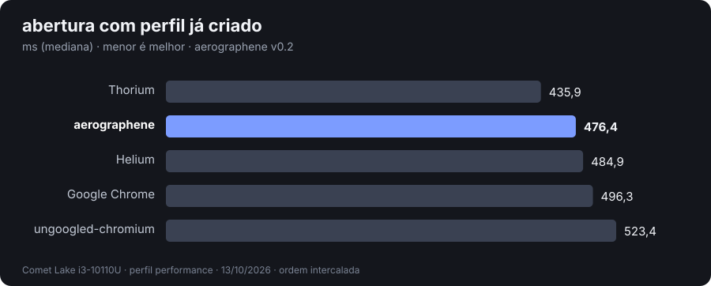
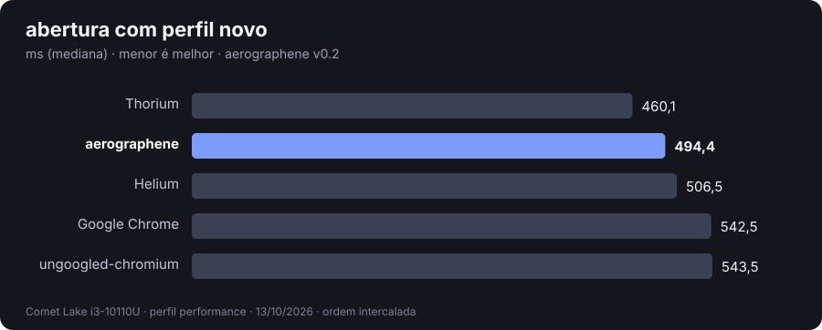
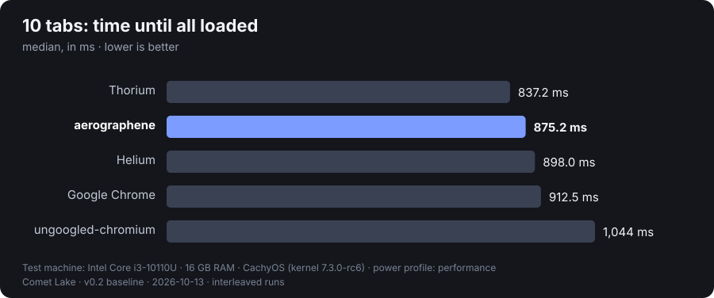
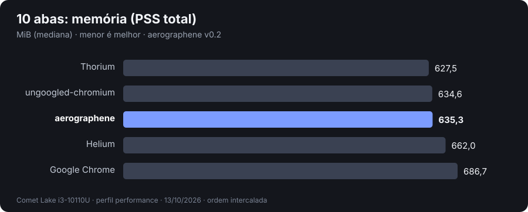
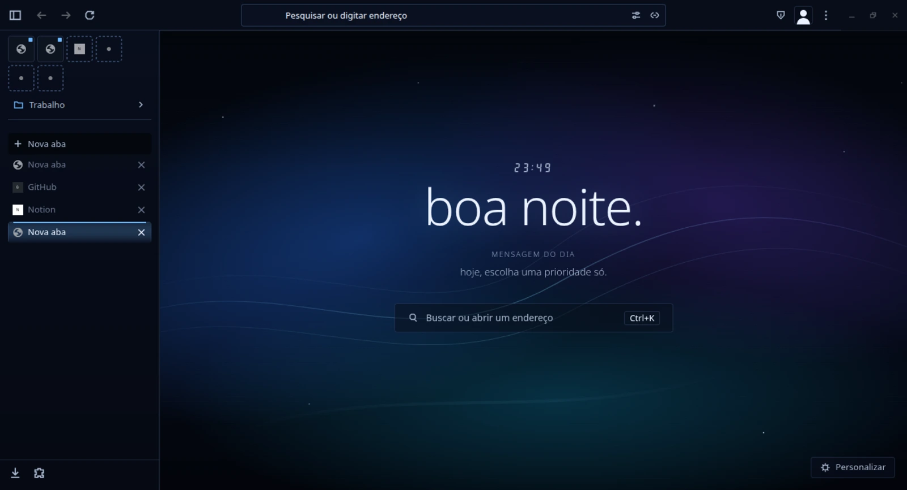
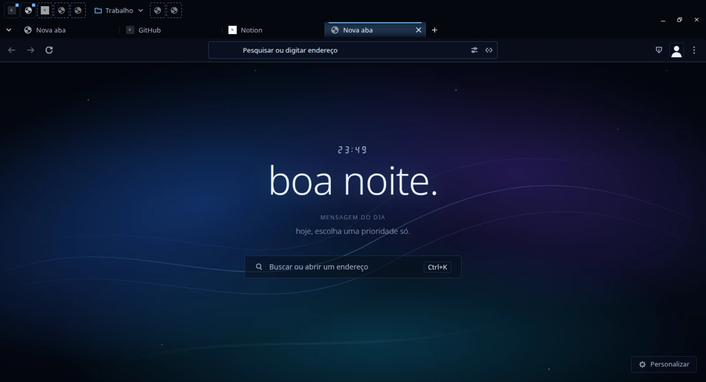
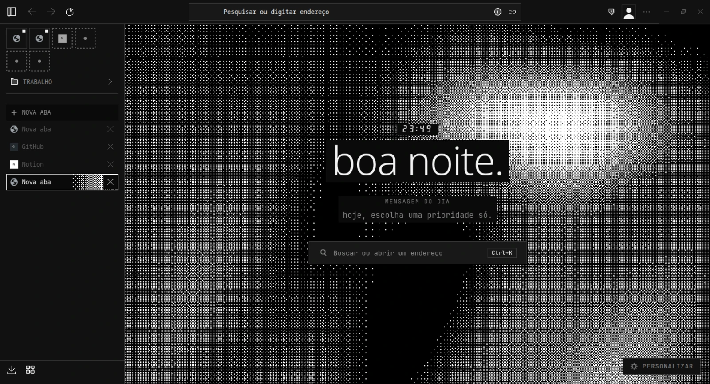
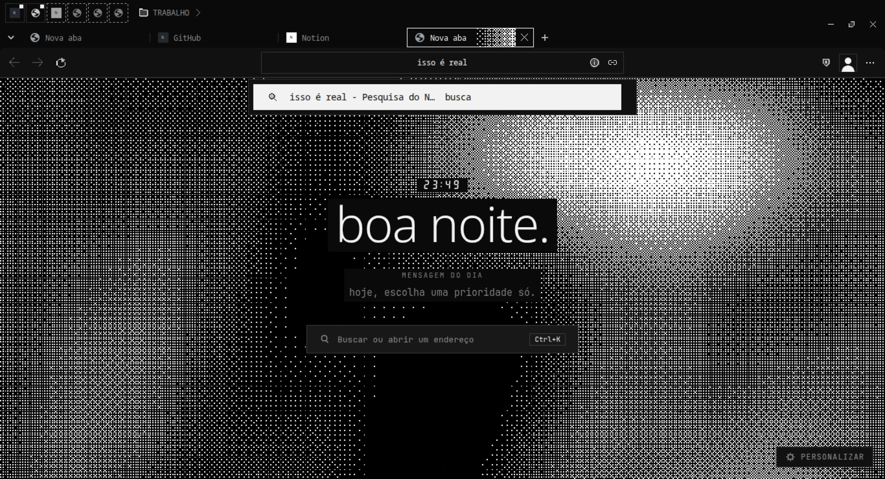

<!-- bench-charts: autorizado pelo dono; gerado por bench/charts.py -->

  
  

  
  

v0.2 baseline, Comet Lake i3-10110U, interleaved runs, median, lower is better. Details and limits: <a href="docs/BASELINE.md">BASELINE</a>.

  

  
  
  
  
  
  

  
  
  
  

# AEROGRAPHENE

## EN
Ungoogled-Chromium-based browser with a focus on not getting much heavier (on the disk) over time, with startup times aimed at similar/better than Helium.
V0.1 brings custom theming and general use with pinned items similar to Arc/Zen, coupled with folders to hide and show groups of pinned items. Also comes with a centered command bar and a very different design.
By v0.3, I aim to have it fully compatible with x86-v3 (current default) and x86-v2 for use in machines lacking AVX2, and to integrate Obsidian and terminals directly inside workspaces in the browser.

Made by dashwr, with giant help from Sonnet 5.5, Opus 5.5, 6.1 Sol and 6 Luna. Don't trust the code? Check it out yourself, it's licensed under GPL-3.0.

## PT
Navegador baseado em Ungoogled-Chromium, focado em não ficar muito mais pesado (no disco) com o tempo, e com tempo de início mirado em ser semelhante/melhor que o Helium.
V0.1 traz tematização personalizada e uso geral com itens fixados parecido com Arc/Zen, junto de pastas para mostrar e esconder grupos de itens fixados. Também acompanha uma barra de comando centralizada e um design diferentão.
Até a v0.3, quero ter compatibilidade total com x86-v3 (padrão atual) e x86-v2 para uso em máquinas sem AVX2, e integrar Obsidian e terminais diretamente dentro de áreas-de-trabalho no navegador.

Feito por dashwr, com ajuda gigante de Sonnet 5.5, Opus 5.5, 6.1 Sol e 6 Luna. Não confia no código? Verifique ele, é licensiado sob GPL-3.0.

## THANKS
I IMMENSELY thank projects such as Ungoogled-Chromium, Helium, Thorium and Brave. This browser is based on Ungoogled, with the genius patches provided with Helium, and using some Thorium and Brave tricks. Without these cool projects and their amazing contributors, aerographene would be either stuck in ideation or take much longer to get usable. A full inventory and a thank-you from my agent are at the bottom of this document.

  

  &nbsp;&nbsp;
  &nbsp;&nbsp;
  &nbsp;&nbsp;
  

> ### Content above was 100% human-written. Content below will be updated constantly by AI to reflect the browser's real roadmap and current capabilities, together with instructions and documentation links.

## roadmap

- ✅ v0.1: Linux x86-64-v3, released as [v0.1.0](https://github.com/newcortexbr/aerographene/releases/tag/v0.1.0)
  - ✅ sidebar with a pinned grid, folders and drag-to-folder
  - ✅ topbar mode with a pinned row and folders
  - ✅ centered command bar with per-type icons
  - ✅ peek (popups and `target=_blank`) and split view
  - ✅ spaces as profiles, one window each
  - ✅ two built-in themes: default and pixelized
  - ✅ cold data for history, favicons, sessions and downloads (30 days)
  - ✅ uBlock Origin (MV2) built in and on by default; Arc importer for pinned items
  - ✅ readable process names, `.tar.zst` release and PKGBUILD
  - ✅ baseline: faster startup than Helium, same-or-lower memory ([BASELINE](docs/BASELINE.md))
- 🚧 v0.2
  - ✅ internal pages (history, settings, security) follow the theme
  - ⬜ real-use test of spaces, command bar, peek and split view
  - ✅ site cache deleted after 30 days, cookies kept ([ADR 0007](docs/adr/0007-dado-frio.md))
  - ✅ theme picker in settings, local theme folder and `.aerotheme` import (opening the file imports it too) ([temas](docs/wiki/temas.md)); built and smoke-tested, not yet tested by hand
  - ✅ v0.2 baseline against Helium, Thorium, Chrome and ungoogled: no metric worse than Helium; Thorium still faster at startup ([BASELINE](docs/BASELINE.md#linha-de-base-v02-13102026-aerographene-3bb3c2f-build-38293664167))
- 🚧 v0.2.1
  - ✅ orphaned `.install-*` folders in the theme folder are removed at startup, off the UI thread
  - ✅ pixelized: square checkbox and radio on internal pages
  - ✅ theme folder names read as raw bytes (non-ASCII names now work under a `C` locale); unit tests for the theme repository and `.aerotheme` import ran for the first time: 18 of 18 pass
  - ✅ built and smoke-tested ([build 38346594627](https://github.com/newcortexbr/aerographene/actions/runs/38346594627)); known gaps: sidebar live tabs are not a drag source and drag has no image; no runtime check of internal pages
- ⬜ v0.3
  - 🚧 Windows 10 and 11 (nothing 11-only; tested on 11) by cross-compiling on the Linux runner ([ADR 0008](docs/adr/0008-windows-11.md), [windows](docs/wiki/windows.md)): toolchain set up, `gn gen` passes and small Windows binaries link (PE32+); the same patch series now compiles for Windows (spaces, themes, notes page; vault reading and the terminal still Linux-only); the browser itself is not built yet
  - 🚧 x86-64-v2 + AVX build for CPUs without AVX2 ([ADR 0009](docs/adr/0009-build-ivy-bridge.md)): build input `cpu=avx1` (separate `out/` and ccache) written; the first avx1 build has not run
  - 🚧 native packages from the compiled tarball: `.pkg.tar.zst` (PKGBUILD), `.deb`, `.rpm` ([pacotes](docs/wiki/pacotes.md)); install/remove/`--version` tested in Arch, Ubuntu 24.04 and Fedora containers, release workflow not yet run
  - 🚧 notes page `aerographene://notes` (Obsidian-style vault) ([notas](docs/wiki/notas.md)): approved F2B layout in code (side modes files/search/tags, open-note tabs with unsaved marker, folder counts, status bar with backlinks/words/line:column, read/edit toggle, recent notes; "+ folder", vault switcher and sort-by-date are visible but disabled until the backend supports them), folder picker, lazy vault tree, safe Markdown view and a live-preview editor (atomic save with conflict warning, create/rename/delete notes, no symlink following), vault watcher, search and embedded images, one notes tab per window, Ctrl+N creates a note while the notes tab is active (new window elsewhere; in code, not compiled yet) and command bar `o:` / `o: <term>` (term = search results in the page, bare `o:` = new tab) wired in code; unit tests pass; not tested as a real `chrome://notes` page yet; the tab title is always `o: <vault name>`
  - 🚧 terminal board `aerographene://terminal` ([terminal](docs/wiki/terminal.md)): pannable and zoomable board of draggable windows with a persisted layout, each an xterm.js wired to a local shell (pty in the browser process, restricted to that page); tab title `t: workspace N`, opened in a new tab from the command bar with `t:` or `t: <command>` (the command is typed into the first terminal, never put in the URL); every terminal starts with a fastfetch-style summary with the cat; sidebar of open terminals; `o:` alone also opens a new notes tab; unit tests pass; not tested in the browser yet, security review pending
  - 🚧 Ctrl+T opens the command bar centered in the window instead of an empty tab; Enter opens a new tab, Esc or a click outside closes it ([command bar](docs/wiki/command-bar.md)); compiled, not tested in the browser yet
  - 🚧 settings in the One UI look (appearance only, same content): rounded cards, big toggles, pill selects and buttons, colored round icons in the side menu, also on Customise profile; light and dark follow the browser theme ([configurações](docs/wiki/settings.md)); series applies with fuzz 0 and the settings resources build; not tested in the browser yet
  - 🚧 Ctrl+Tab tab switcher: a centered grid of the window's tabs in most-recently-used order (pinned included) with thumbnails, favicon, title and host; hold Ctrl and press Tab to move, release Ctrl to switch, Esc cancels; Ctrl+PgDn/PgUp unchanged ([tab switcher](docs/wiki/tab-switcher.md)); series applies; compile check pending; not tested in the browser yet
  - 🚧 first-use defaults: Google as default search engine in new profiles, chromium-web-store extension bundled (pinned by version + sha256) and `extension-mime-request-handling` on, so `.crx` from the Chrome Web Store can be installed ([padrões e extensões](docs/wiki/padroes-e-extensoes.md)); patch applies and the affected targets compile; not tested in the browser yet
  - 🚧 Helium services and setup page removed; no native Chromium first-run screen ([padrões e extensões](docs/wiki/padroes-e-extensoes.md)); series applies and the affected files compile (syntax-only)
  - 🚧 own first-use page `aerographene://setup`, opened once per new profile (space) instead of the new tab page ([onboarding](docs/wiki/onboarding.md)): eight steps wired only to real controls (theme, search engine, notes folder, default browser, search suggestions, import page of settings); skip concludes with no change; never in incognito or guest, never again after it is concluded (`aerographene.onboarding_completed`); no network, no external font or image; page tested in headless Chrome with a fake backend, not in the browser yet
  - 🚧 Helium extras out of scope removed (MRU tab cycling, keyboard shortcuts, Shift+right-click native menu, new tabs next to the active one, window-menu customize item, crash-reporting prefs); the whole patch series now applies with `--fuzz=0`; affected files compile (syntax-only); not tested in the browser yet
  - 🚧 optional selective `-O3` ([build](docs/BUILD.md)): V8, partition_alloc and Blink `core_hot` are already `-O3` upstream; build input `o3=hot|wide` raises Blink `platform`/`heap` (and `base`) to `-O3` and produces a `-o3<profile>` package; off by default, not measured yet
  - 🚧 spaces look and wording ([spaces](docs/wiki/spaces.md)): avatar menu, space picker and new-space steps restyled in the mono look (square corners, no Chromium banners or origami avatars, the avatar is a glyph with the space's initial) and "profile" worded as "space" (en and pt-BR, 32 messages through `build/strings_space.json`); looks only, same flow; the series applies with `--fuzz=0` and the menu file compiles (syntax-only); the WebUI resources are not built and none of it was seen in the browser yet
  - ⬜ Google Sync with own API keys ([ADR 0006](docs/adr/0006-google-sync-com-chaves-proprias.md))

## docs

the wiki lives in [`docs/wiki/`](docs/wiki/), in pt-BR.

- [temas](docs/wiki/temas.md): how themes load (built-in theme, `theme.json` tokens, extension themes), where to change them and how to make your own. Ends with a dense spec you can paste into your AI agent so it writes a valid theme for you.
- [benchmark](docs/wiki/benchmark.md): how the startup/memory baseline is measured and charted.

- [notas](docs/wiki/notas.md): the notes page (`aerographene://notes`), what exists today and how vault access is confined. Ends with a summary for agents.

- [terminal](docs/wiki/terminal.md): the terminal board (`aerographene://terminal`), the pty session and its security rules. Ends with a summary for agents.

- [windows](docs/wiki/windows.md): cross-compiling the Windows 10/11 build on the Linux runner, what works, what the source tarball lacks. Ends with a summary for agents.

- [command bar](docs/wiki/command-bar.md): how the command bar opens (URL click, Ctrl+L, Ctrl+T centered in the window), what Enter/Esc do. Ends with a summary for agents.

- [tab switcher](docs/wiki/tab-switcher.md): Ctrl+Tab switcher, MRU order, thumbnails and their memory limits, what cancels it. Ends with a summary for agents.

- [pacotes](docs/wiki/pacotes.md): release assets (`tar.zst`, `pkg.tar.zst`, `deb`, `rpm`, per CPU target), how to install and remove, what gets installed, how the packages are built. Ends with a summary for agents.

- [configurações](docs/wiki/settings.md): the One UI look of `chrome://settings` and Customise profile, how the `--oneui-*` variables work. Ends with a summary for agents.
- [onboarding](docs/wiki/onboarding.md): the first-use page (`aerographene://setup`), when it opens, what each step changes and what it does not. Ends with a summary for agents.

- [padrões e extensões](docs/wiki/padroes-e-extensoes.md): Google as default search engine in new profiles, the bundled chromium-web-store extension (pinned by version + sha256) and `extension-mime-request-handling` on by default. Ends with a summary for agents.

- [spaces](docs/wiki/spaces.md): how the avatar menu, the space picker and the new-space steps look, how "profile" becomes "space" in the strings, and what is not done (glyph choice, themed picker). Ends with a summary for agents.

for builders: [scope](docs/SCOPE.md), [build](docs/BUILD.md), [packaging](docs/PACKAGING.md), [decisions](docs/adr/), [patch origins](patches/README.md).

## thanks

aerographene stands on the shoulders of three projects. Thank you, immensely, to everyone who works on them.

### ungoogled-chromium

the base. Every aerographene build is ungoogled-chromium plus our patch series.

- taken as is: removal of Google services, telemetry and variations; `disable-ai`; Manifest V2 support (which keeps full uBlock Origin alive).
- changed: product name, icon and data directory (`~/.config/aerographene`); x86-64-v3 compiler target with ThinLTO and PGO; everything in the series below sits on top.

### Helium

the source of most of our ported work: 34 of the patches in [`patches/series`](patches/series) come from Helium.

- taken: infinite tab freezing, memory saver on by default, lazy session restore, low-power framerate flag, uBlock Origin installed as a component, vertical and compact layouts, centered address bar, split view, side panel, tab context menus (hibernate, copy URL), Arc importer and the custom internal-page protocol.
- changed: hunks rebased onto Chromium 154 without the rest of Helium's tree; `helium://` shown as `aerographene://`; the vertical layout trimmed (no tab search host, no corner refs) and given a compact toolbar width; uBlock defaults reconfigured and its toolbar icon themed; Helium's own services (settings page, `services.helium.imput.net`), its setup page (`chrome://setup`) and sync left out; MRU tab cycling, keyboard shortcuts, Shift+right-click native menu, new tabs next to the active one, window-menu customize item and crash-reporting prefs removed as out of scope.

### Thorium

the performance yardstick and the model for a few decisions.

- taken: Thorium is part of our benchmark baseline ([BASELINE](docs/BASELINE.md)); its approach of shipping builds with the maintainer's own Google API keys is the plan for sync ([ADR 0006](docs/adr/0006-google-sync-com-chaves-proprias.md)).
- changed: no Thorium code is in the tree; the sync plan adapts its key approach to an ungoogled base, which first needs a login test.

also thanks to Brave, for the two patches behind the Arc importer.
